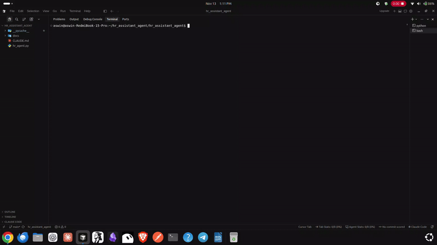
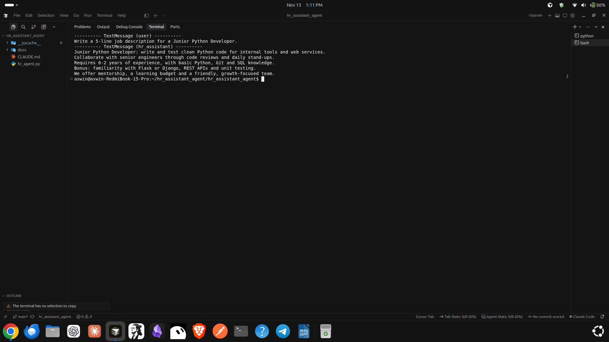

# HR Assistant Agent

A minimal [AutoGen](https://microsoft.github.io/autogen/) agent that acts as an HR assistant. It asks an OpenAI model to write a 5-line job description for a Junior Python Developer and prints the reply in the terminal.



## What it does

- Creates an `AssistantAgent` named `hr_assistant` with the system message `"You are an HR assistant."`
- Uses `OpenAIChatCompletionClient` (`gpt-4o-mini`) as the model client
- Sends the task: *"Write a 5-line job description for a Junior Python Developer."*
- Streams the conversation to the terminal with `Console`
- Runs inside `asyncio.run()` (AutoGen is async) and closes the model client when finished

Everything lives in a single file: [`hr_agent.py`](hr_agent.py).

## Setup

```bash
python -m venv venv && source venv/bin/activate
pip install -U autogen-agentchat "autogen-ext[openai]"
export OPENAI_API_KEY=sk-...   # never hard-code your key
```

## Run

```bash
python hr_agent.py
```

## Output



## Tech stack

Python 3.10+ · `autogen-agentchat` · `autogen-ext[openai]` · OpenAI API
